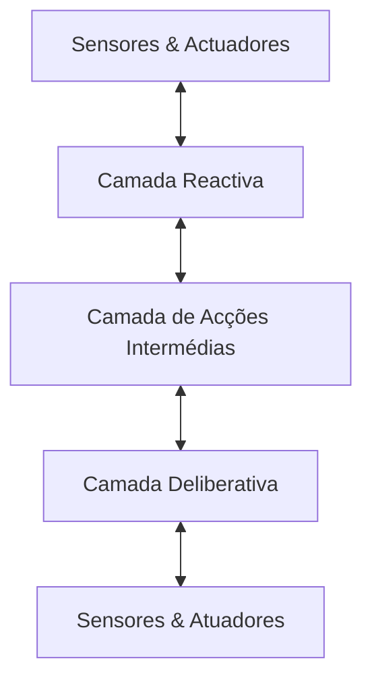
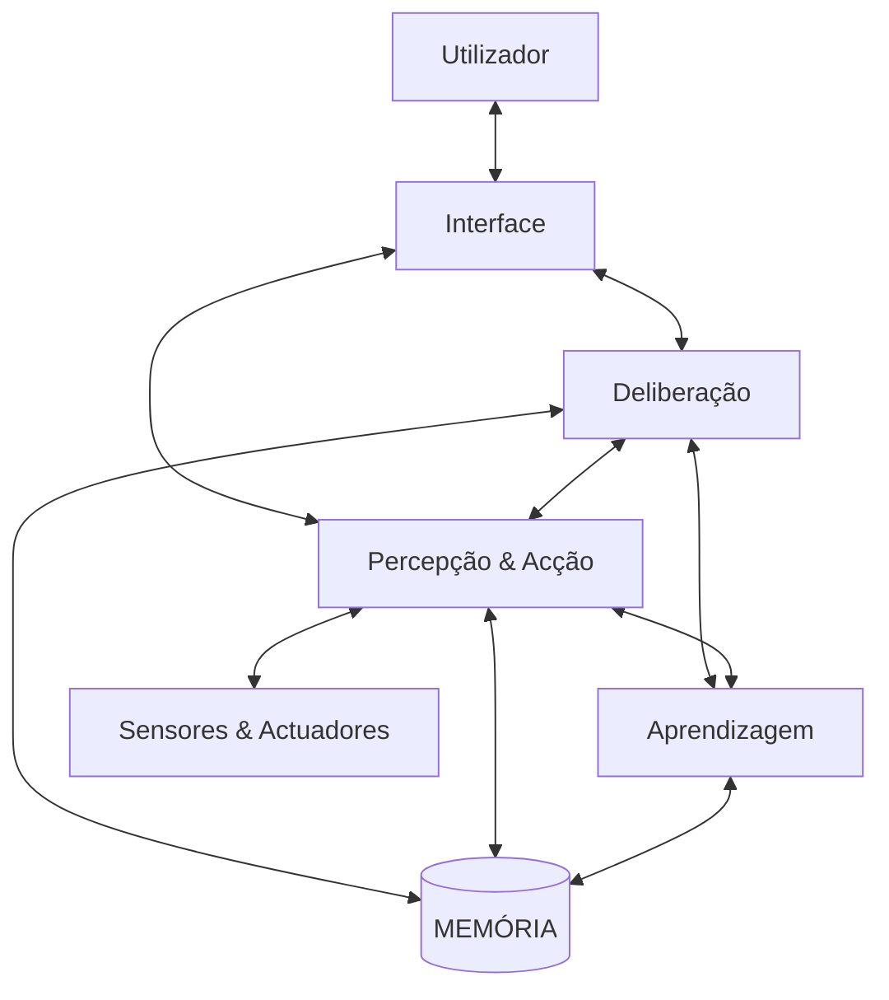

# Tópicos IA

Definição de inteligencia: 
- Capacidade de adquirir e aplicar conhecimento
- Capacidade de pensar e reciocinar 
- O conjunto de capacidades superiores da mente

**Albus**, 

- Como adquirir, representar e armazenar conhecimento
- Como gerar comportamento inteligente
- Como surgem e são utilizadas as motivações, emoções e prioridades
- Como as perceções (sinais) dão origem a entidades simbólicas 
- Com raciocinar sobre o passado
- Como planear acções futuras

**Russel & Norvig** 

| Pensar como o ser humano | Pensar Racionalmente | 
| --- | --- | 
| Agir como o ser humano | Agir Racionalmente | 

# Teste de turing 

"Comportamento inteligente" – a capacidade de um artefacto
obter desempenho comparável ao desempenho humano em
todas as actividades cognitivas.

Teste de Turing – é uma definição operacional de
comportamento inteligente de nível humano:

- Consiste em submeter o artefacto a um interrogatório realizado por um ser humano através de um terminal de texto.

- Se o humano não conseguir concluir se está a interrogar um artefacto ou outro ser humano, então, esse artefacto é inteligente.

# IA "restrita", "forte", "geral", "fraca"

- A “IA restrita” centra-se no desenvolvimento de sistemas de IA
especializados que apenas conseguem resolver uma tarefa ou
uma gama limitada de tarefas.

- A “IA geral” centra-se no desenvolvimento de máquinas
capazes de aplicar a inteligência a qualquer problema.

- A “IA fraca” na literatura filosófica refere-se a visões da IA em
que as simulações (parciais) da mente humana não são
consideradas mentes.

- A “IA forte” na literatura filosófica refere-se a visões da IA em
que os sistemas que simulam corretamente a mente humana são,
eles próprios, considerados mentes.

# Agentes

O termo “agente” tem dois significados principais:
- Entidade com poder ou autoridade para agir
- Entidade que actua em nome de outra

Agente – entidade com capacidade de obter
informação sobre o seu ambiente (através de
“sensores”) e de executar acções em função dessa
informação (através de “actuadores”).

## Tipos de Agentes

Reactivos
- Simples
- Com estado

Deliberativos
- Orientados por objetivos
- Orientados por medidas de utilidade

# Propriedades do mundo de um agente
- Acessibilidade – o mundo é “acessível” se os sensores do agente
permitem obter uma descrição completa do estado do mundo; o mundo
será “efectivamente acessível” se é possível obter toda a informação
relevante ao processo de escolha das acções.
- Determinismo – o mundo é “determinístico” se o estado resultante da
execução de uma acção é totalmente determinado pelo estado actual e
pelos efeitos esperados da acção.
- Mundo episódico – no caso em que cada episódio de percepção-acção é
totalmente independente dos outros.
- Dinamismo – o mundo é “dinâmico” se o seu estado pode mudar
enquanto o agente delibera; caso contrário, o mundo diz-se “estático”.
- Continuidade – o mundo é “continuo” quando a evolução do estado do
mundo é um processo continuo ou sem saltos; caso contrário o mundo
diz-se “discreto”.

# Arquiteturas de Agentes

## Quadro preto

- Podem ser vistos como uma
elaboração dos sistemas reactivos
com estado interno.
- Uma “fonte de conhecimento”
(FC) é um programa que vai
fazendo alterações no Quadro
Preto.
- Uma FC pode ser vista como um
especialista num dado domínio.
- Tipicamente, cada FC rege-se por
um conjunto de regras de
situação-acção

## BDI Beliefs-Desires-Intentions

Crenças – informação que o agente possui sobre o mundo
- Desejos – estados de coisas que o agente gostaria de ver
- Intenções – estados de coisas que o agente se propõe atingir
- Esta é uma arquitetura para agentes com recursos
limitados
- Combina a análise meios-fins com uma avaliação
comparativa de alternativas

## Três Camadas

## Subsunção 

- A arquitectura de subsunção [Brooks,1986; Connell,1990] procura
estabelecer a ligação entre percepção e acção a vários níveis – daqui
resulta uma organização em camadas.
- A camada mais baixa é a mais reactiva.
- O peso da componente deliberativa aumenta à medida que se sobe
na estrutura de camadas.

## CARL

# Técnicas de Resolução de Problemas

Pesquisa em árvore em largura → FIFO

Pesquisa em árvore em profundidade → LIFO

# Avaliação das estratégias de pesquisa
- Completude – uma estratégia é completa se é capaz de
encontrar uma solução quando existe uma solução
- Complexidade temporal – quanto tempo demora a
encontrar a solução
- Complexidade espacial – quanto espaço de memória é
necessário para encontrar uma solução
- Optimalidade – a primeira solução que a estratégia de
pesquisa consegue encontrar é a melhor solução.

# Pesquisa A*

$f(n)=g(n)+h(n)$

A função heurística h(n) diz-se admissível se nunca
sobrestima o custo real de chegar a uma solução a
partir de n.

Se for possível garantir que h(n) é admissível, então a
pesquisa A* encontra sempre (um)a solução óptima.

# Pesquisa de custo uniforme

$h(n) = 0$
$f(n) = g(n)$
- É um caso particular da pesquisa A*
- Também conhecido como algoritmo de Dijkstra
- Tem um comportamento parecido com o da pesquisa em largura
- Caso exista solução, a primeira solução encontrada é óptima

# Pesquisa gulosa
- Ignora custo acumulado g(n)
$f(n) = h(n)$
- Dado que o custo acumulado é ignorado, não é verdadeiramente um caso
particular da pesquisa A*
- Tem um comportamento que se aproxima da pesquisa em profundidade
- Ao ignorar o custo acumulado, facilmente deixa escapar a solução óptima

# Fatores de ramificação 

- N – número de nós da árvore de pesquisa no momento em que se encontra a solução
- X – Número de nós expandidos (não terminais)
- d – comprimento do caminho na árvore correspondente à solução

Ramificação média – número médio de filhos por nó expandido, indicador da dificuldade do problema:

$ RM = \frac{N-1}{X}

Factor de ramificação efectivo – número de filhos por nó, B,
numa árvore com ramificação constante e com profundidade constante d, é um indicador da eficiência da técnica de pesquisa
utilizada.. Portanto:

$\frac{B^{d + 1}-1}{B-1} = N$

# STRIPS

A funcionalidade de um dado tipo de operação é definida, no
formalismo STRIPS, através de uma estrutura chamada operador,
que inclui a seguinte informação:
- Pré-condições - um conjunto de fórmulas atómicas que representam as
condições de aplicabilidade deste tipo de operação.
- Efeitos negativos (delete list) – um conjunto de fórmulas atómicas que
representam propriedades do mundo que deixam de ser verdade ao executar-
se a operação.
- Efeitos positivos (add list) – um conjunto de fórmulas atómicas que
representam propriedades do mundo que passam a ser verdade ao executar-se a operação

# Pesquisa A* em aplicações práticas
## Principais vantagens
- Completa
- Óptima
## Principais desvantagens
- Na maior parte das aplicações, o consumo de memória e tempo de
computação têm um comportamento exponencial em função do tamanho
da solução
- Em problemas mais complexos, poderá ser preciso utilizar algoritmos
mais eficientes, ainda que sacrificando a optimalidade
- Ou então, usar heurísticas com uma melhor aproximação média ao custo
real, ainda que não sendo estritamente admissíveis, e não garantindo
portando a optimalidade da pesquisa

# IDA* (Iterative Deepening A*)
 Semelhante à pesquisa em profundidade com
aprofundamento iterativo
 A limitação à profundidade é estabelecida
indirectamente através de um limite na função de
avaliação f(n) = g(n)+h(n) <= fmax
- Ou seja: Qualquer nó n com f(n)> fmax não será expandido
• Passos do algoritmo:
1. fmax = f(raiz)
2. Executar pesquisa em profundidade com limite fmax
3. Se encontrou solução, retornar solução encontrada
4. fmax ← menor f(n) que tenha sido superior a fmax na última
execução do A*
5. Voltar ao passo 2

# RBFS
- Pesquisa recursiva melhor-primeiro (Recursive Best-
First Search)
- Para cada nó n, o algoritmo não guarda o valor da
função de avaliação f(n), mas sim o menor valor f(x),
sendo x uma folha descendente do nó n
- Sempre que um nó é expandido, os custos armazenados nos
ascendentes são actualizados
- Funciona como pesquisa em profundidade com
retrocesso
- Quando a folha m com menor custo f(m) não é filha do
último nó expandido n, então o algoritmo retrocede até ao
ascendente comum de m e n

# SMA*
- A* com memória limitada simplificado (simplified memory-
bounded A*)
- Usa a memória disponível
- Contraste com IDA* e RBFS: estes foram desenhados para poupar
memória, independentemente de ela existir de sobra ou não
- Quando a memória chega ao limite, esquece (remove) o nó n
com maior custo f(n)=g(n)+h(n), actualizando em cada um dos
nós ascendentes o “custo do melhor nó esquecido”
- Só volta a gerar o nó n quando o custo do melhor nó esquecido
registado no antecessor de n for inferior aos custos dos restantes
nós
- Em cada iteração, é gerado apenas um nó sucessor
- Existindo já um ou mais filhos de um nó, apenas se gera ainda outro se o
custo do nó pai for menor do que qualquer dos custos dos filhos
- Quando se gerou todos os filhos de um nó, o custo do nó pai é
actualizado como no RBFS

# Redes Semânticas

- Redes semânticas são representações gráficas do
conhecimento
- Têm a vantagem da legibilidade
- As redes semânticas podem ser tão expressivas quanto
a lógica de primeira ordem

